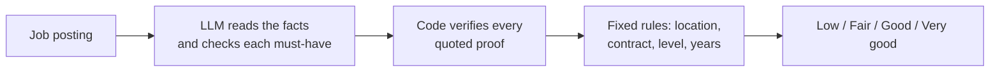

# README & Repo Polish

All project READMEs follow the same structure so they look like one consistent portfolio. Write in **English**.

A README is the front door of a portfolio project, not a manual. It should read like an experienced developer wrote it in a calm hour: short, clear, no filler. A visitor decides in two minutes. Anything they don't need in those two minutes goes into the code, the app itself (tooltips, empty states) or a separate file like `docs/` or `eval/README.md`.

## Length

- The whole README must be readable in **2 minutes**: under **900 words** and under **150 lines**. Shorter is better.
- Check with `wc -w README.md` and `wc -l README.md` before finishing. Over the limit → cut, don't squeeze.

## Structure (always in this order)

1. `# <emoji> Project Name` — one fitting emoji. Badges directly below, max. 3, only ones that show something real (CI, license, deploy).
2. **Description** — **1–2 sentences**: what it does and for whom.
3. **Screenshot** — ``. Current, sharp, the app's main view. A short GIF of the main flow is even better.
4. `## Tech Stack` — bullet list in backticks for small projects, or a table (Area | Choice) for bigger ones.
5. `## How It Works` *(optional)* — or a more specific name like `## How Scoring Works`. Explains **the one interesting technical idea** of the project: a small Mermaid diagram (max. ~6 boxes) plus 1–3 sentences. Skip it if the project has no idea worth explaining; a plain CRUD app doesn't need one.
6. `## Evaluation` *(optional, AI projects)* — one sentence on the method, a small table with 2–4 numbers, a link to the details (e.g. `eval/README.md`). Only real, measured numbers.
7. `## Features` — max. **8–10** bullets. Each feature exactly **one line**, max. ~15 words, no sub-bullets, no grouping. Format: `- **Feature name** — short explanation.`
8. `## Live Demo` — just the link, e.g. `[my-app.vercel.app](https://my-app.vercel.app/)`, plus a guest/demo login if there is one. For VS Code extensions use `## Install` with the Marketplace link instead.
9. `## ⚙️ Installation` — only what a first local start needs:
   - **Prerequisites** in one line (e.g. Node.js version, accounts needed)
   - Max. **5–6** numbered steps with `bash` code blocks
10. Optional, only if useful, in this order:
    - `## Environment Variables` — table: Variable | Description | Required. Names only, no values.
    - `## Tests` — the commands, plus one line on what runs in CI.
    - `## Deployment` — 1–3 sentences, only what's non-obvious.
    - `## Security Considerations` — max. **4** bullets, one line each. What was done.
    - `## Limitations` — max. **4** bullets, one line each. What it deliberately doesn't do, known gaps.
11. `## License` — always last. E.g. "MIT, see [LICENSE](LICENSE)." If the code should not be reused: "All rights reserved."

## Leave out

- `## Learn More`, `## Table of Contents` (GitHub shows its own outline), `## Usage`, `## Available Scripts`, `## Folder Structure`, `## Contributing`.
- Example payloads, request/response samples.
- Tables of settings, options or CSV columns (the Environment Variables table is the only config table).
- Walkthroughs of individual pages or screens.
- Anything said elsewhere in the README. Every piece of information appears **at most once**.

## Style

- Numbers instead of adjectives: "87 % right tier" instead of "very accurate", "234 tests" instead of "well tested".
- No marketing words: seamless, powerful, robust, cutting-edge, blazing fast, effortless, comprehensive, leverage, etc.
- Short sentences. No chains of em dashes in running text. (The `—` in feature bullets is fine.)
- No "This project…", "Simply…", "Whether you're X or Y…" openers. Say what it does.
- Honest: only features that are actually built. Unfinished ones are left out.

## Rules

- Use exactly these heading names. "Tech Stack", not "Technologies"; "Installation", not "Getting Started" or "Setup"; "Deployment", not "Deploying to Vercel".
- No emojis in `##` headings, except `## ⚙️ Installation`.
- No `---` horizontal rules.
- **No sensitive data:** never real secrets, passwords, API keys or customer data. Only variable names and placeholders from `.env.example`.
- **When reworking an existing README: cut hard.** Don't preserve text because it exists. Keep a fact only if a visitor needs it in the first 2 minutes; move useful details into a separate file and link it, or drop them.
- Check that all commands in Installation actually work on a fresh clone.
- Check that image paths and links work, and that the Mermaid diagram renders on GitHub.

## Example (excerpt of a finished README)

From [ai-job-hunter](https://github.com/lvfranek/ai-job-hunter/blob/main/README.md). Note the 2-sentence description, the single idea in How It Works, and one-line features.

````markdown
# 🔍 AI Job Hunter

[](https://github.com/lvfranek/ai-job-hunter/actions/workflows/ci.yml)

Scrapes five German job boards, rates your chance at every job with an LLM and writes a cover
letter for the ones you like. Works for any profession, not just software.


## Tech Stack
...

## How Scoring Works

Asked for a score, an LLM gives a different number every run. So here the model decides
nothing: it only reads the posting and fills in a checklist. Code makes the call.



If the model says you know Kubernetes, it has to quote the line in your profile that proves it.
Code checks that quote word for word, so an invented skill counts as missing.

## Evaluation

30 made-up postings with traps (a working-student job hidden in the text, home office mentioned
only at the very end), each scored 3 times by the real model.

| Right tier | Same tier in all 3 runs | Cost per job |
| ---------- | ----------------------- | ------------ |
| 87 %       | 90 %                    | $0.0003      |

What it found and how it works: [eval/README.md](eval/README.md).

## Features

- **One scan, five boards** — Indeed, LinkedIn, Xing, Stepstone and the Arbeitsagentur.
- **Chance tiers** — every job gets Low, Fair, Good or Very good, with the reasons on the card.
- **Work locations** — remote, or the cities you'd commute to, each with its own radius.
- **Cover letters** — one click writes a German or English letter and downloads it as Word.
- **CV import** — fills in your skills and contact details from a CV. The file isn't stored.
- **Application tracker** — every application in one list, added from the dashboard, by hand or from CSV.
- **Keyword stats** — shows which search keywords actually find jobs worth applying to.
- **Scheduled scans** — a cron endpoint scrapes and scores, then posts new good matches to a webhook.
````

## Repo polish (GitHub)
- "About" section: one-line description, website link (live demo), 3–6 topics (e.g. `angular`, `supabase`, `kanban`).
- Social preview image set (Settings → Social preview, 1280×640).
- `LICENSE` file matches the License section.
- Default branch clean, no leftover branches with experiments, meaningful recent commit messages.
- Best projects pinned on the GitHub profile.

## Report
The finished README with its word and line count, a short list of what you cut or moved, and anything the user must provide (screenshot, demo link, license choice, eval numbers).
